<h3 align="center">
  Hello! Fellow Dev  
  <a href="https://git.io/typing-svg"><picture><source media="(prefers-color-scheme: dark)" srcset="https://readme-typing-svg.demolab.com?font=Montserrat&weight=600&size=20&duration=3000&pause=1200&color=7AA2F7&center=true&vCenter=true&width=680&height=34&lines=I%27d+rather+find+out+than+assume.;Small+steps%2C+every+day.;Show+me+the+fire%2C+I%27ll+find+where+it+started.;Calm+when+things+break."/><source media="(prefers-color-scheme: light)" srcset="https://readme-typing-svg.demolab.com?font=Montserrat&weight=600&size=20&duration=3000&pause=1200&color=2F6FEB&center=true&vCenter=true&width=680&height=34&lines=I%27d+rather+find+out+than+assume.;Small+steps%2C+every+day.;Show+me+the+fire%2C+I%27ll+find+where+it+started.;Calm+when+things+break."/></picture></a>
</h3>

  

<h4 align="center">Back in a Neural Networks course I came across a model called Life Long Learning. It still describes how I work: learn something new every day, and most of it ends up as a project here.</h4>

<h3 align="center">♫ Meanwhile, I listen to this while I code</h3>

  

  
  
  

  
  

  
  

  
  

<picture>
  <source media="(prefers-color-scheme: dark)" srcset="https://raw.githubusercontent.com/r0han01/r0han01/output/snake-dark.svg"/>
  <source media="(prefers-color-scheme: light)" srcset="https://raw.githubusercontent.com/r0han01/r0han01/output/snake-light.svg"/>
  
</picture>

  

